# 随身录音

出门不用记。跟人正常聊，这块小屏一直在听。回来打开今天的文字，每句都有时间，谁说的也能分开。原始声音不留，云上只存字。

它不是手机里的录音 App。开机就录，不用打开，不用盯着屏幕。屏幕做成一台磁带，平时几乎关着，只在给人看的时候打开。

<p align="center">
  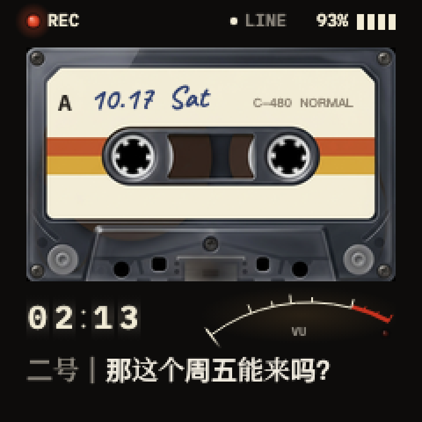
</p>

硬件是买来就焊好的正辰 1.54 寸方屏，ESP32-S3，16MB 闪存，8MB 内存。大约六七十块。三个键：单击 BOOT 开始或停止，双击进声纹名单，长按进联网设置。音量键平时调亮度、开关屏幕；进了声纹页就只用来上下选人。

## 卖点

| | |
| --- | --- |
| 便宜 | 现成焊好的板子，大约六七十块。散件再焊会更低，没必要。 |
| 功能在 | 开机就录。回来是带时间的文字，谁说的已经分开。屏幕是一台磁带，想给人看再打开。 |
| 声纹是为了后面 | 登记过的人能认出来。以后要摘你的话、做方案、挑能拍的点，先知道哪句是谁。说「我是谁」，名字记在声纹上。路人只在这一场里编号，不写进库。 |
| 服务器帮你省 | 没人说话就不送去转写。转写大约 0.86 元一小时说话，安静的不计。声纹、认人声、把一句里的几个人切开，都在自己的机器上算。一台小服务器就能跑。 |
| 声音不留 | 云上只有文字。后面拿去整理，不用先存一大堆录音。 |
| 开源 | 画面、板子、服务器都在这个仓库里。不绑一套会员。 |
| 电不放干 | 屏幕先灭，WiFi 不一直开，电量低了先睡。见下表。 |

电还没放干，板子自己收着：

| 什么时候 | 现在怎么做 |
| --- | --- |
| 用电池，没人看屏幕 | 大约一分钟自己灭。插着电就亮着 |
| 没插电，屏幕已经灭了 | WiFi 攒一会儿再传，传完关掉 |
| 电量到 10% | 先停录，把攒下的传完，再睡下 |
| 开机时电量已经很低 | 先不连 WiFi |

## 现在怎么走

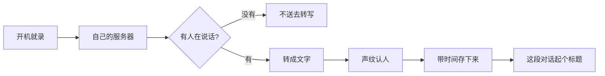

| 这一步 | 现在用什么 |
| --- | --- |
| 转写 | paraformer-realtime-v2，只算送出去的秒 |
| 有没有人声 | 服务器上判断，没声音不花钱 |
| 这句是谁 | CAM++ 声纹。登记过的人像到 0.55 以上就认他 |
| 一句里有好几个人 | 长过 3.5 秒先切开，再按字分给当时在说的人 |
| 起标题 | qwen-flash，一段对话一次 |

这类随身录音卡是一开始的参照。下面是这块自己的。

## 规格

| | |
| --- | --- |
| 板子 | 正辰 1.54 寸方屏，ESP32-S3，16MB 闪存，8MB 内存。别人焊好的，大约六七十块 |
| 屏幕 | 240×240。用电池大约一分钟自己灭，插着电亮着 |
| 续航 | 屏幕关着、用电池，从满电到自己睡，测过一次：6 小时 35 分。这一次声音没有丢。屏幕开着更费电 |
| 联网 | WiFi。出门带一个随身热点 |
| 旁边没有 WiFi | 继续录。板子里大约留最近 25 分钟，再久丢掉最早的，新的还在录。连上之后自己补传 |
| 留下什么 | 带时间的文字，谁说的分开。声音不留 |
| 转写 | 大约 0.86 元一小时说话。没人说话不送出去，那段不计费 |
| 键 | 单击中间键开始或停止，双击进声纹，长按联网。音量键平时管亮度和屏幕，进了声纹页用来上下选 |

## 往哪走

带出门。聊完，文字到你自己的服务器。能做的方案直接开工，回来就在。

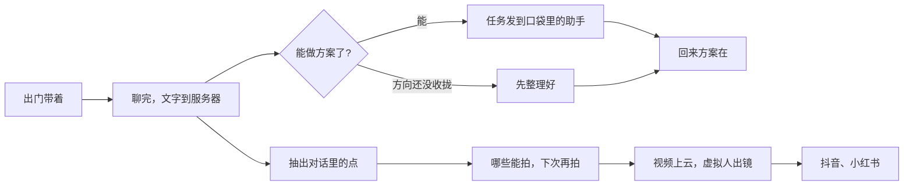

| | |
| --- | --- |
| 出门 | 人在外面聊。助手在家里的电脑上。能做的方案当场开工，回来打开就是。任务和要紧话记下来，一天怎么排，你自己定。 |
| 再往后 | 对话里的点提出来，挑能拍的，下次再拍。视频上云，虚拟人出镜，你不用出镜。然后是抖音、小红书。 |
| 下一台 | 做成一张卡片，看着像在看手机。全程开着录，从三天往五天走。不用再打开一个 App。 |

## 每一屏

屏是 240×240，黑底。中文用宋体，英文和数字用等宽字。顶上那排只有 REC、STOP 这种拉丁词，因为那套字只有英文。底下两行是状态。声纹页把磁带拿开，中间是名单。

| 开机 | 连接中 | 录音中 |
| --- | --- | --- |
| 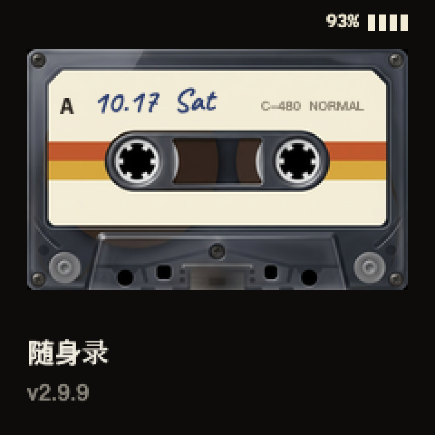 | 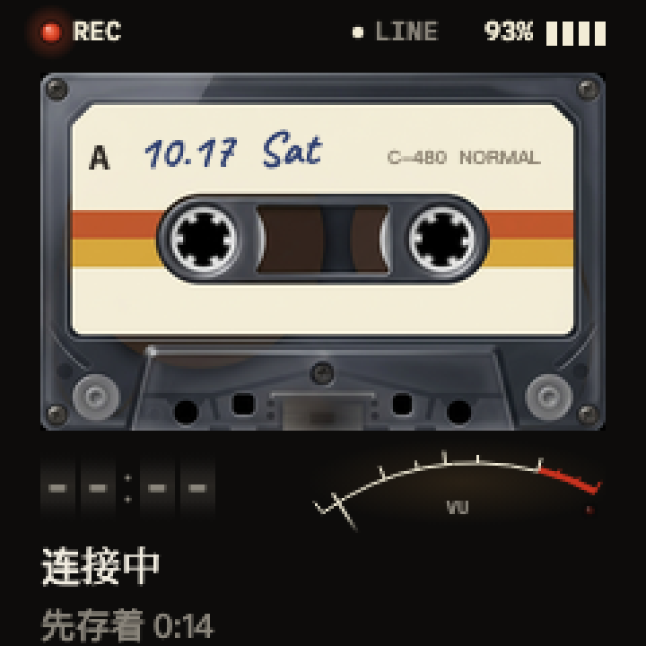 |  |
| 通电后先亮这一屏，版本号是板子上真装的那个。取代小智原来的白屏。 | 正在连 WiFi 和服务器。这时候已经在录，先存在机器里，时间是真的在涨。 | 平时就是这一屏。左下是今天录了多久，右下是麦克风音量，底下是刚说的那句。 |

| 没网 | 补传 | 已停止 |
| --- | --- | --- |
| 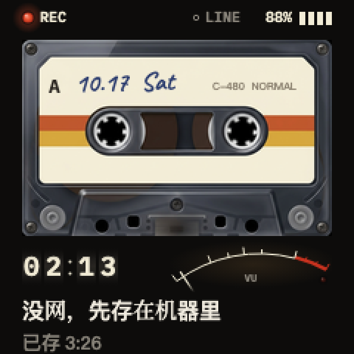 | 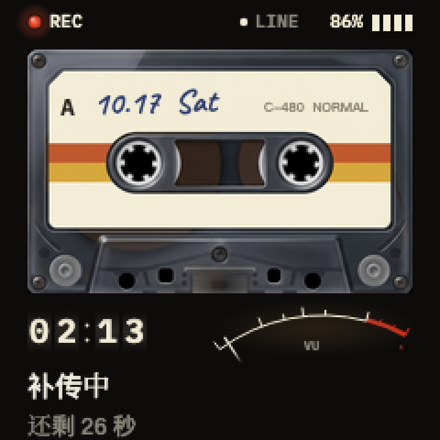 | 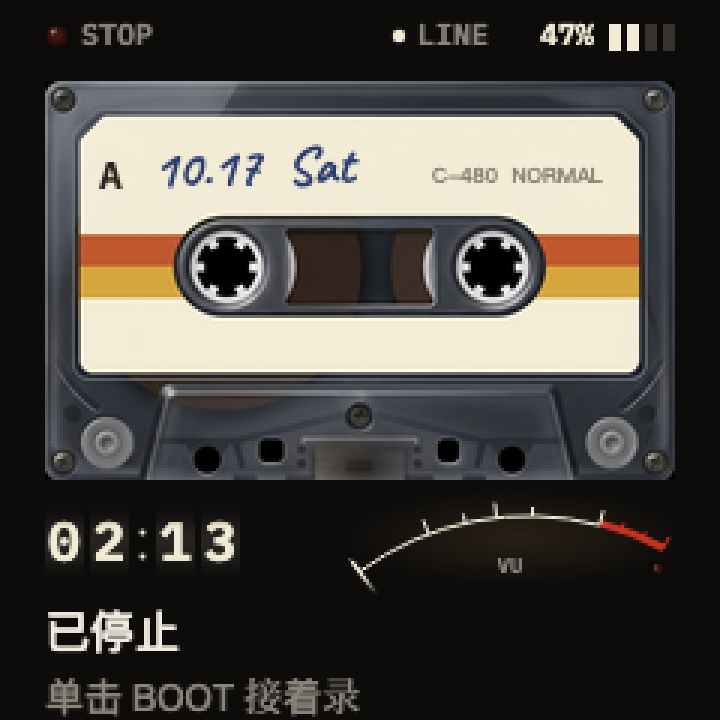 |
| 路上没信号。照样在录，存在机器里，有网了自己补传。 | 刚连上，把存着的那段发出去。传完，字幕就接着出来。 | 单击 BOOT 停下。磁带不转。插着电的时候，电量格子一格格往上走。 |

| 声纹名单 | 录声纹 | 升级中 |
| --- | --- | --- |
| 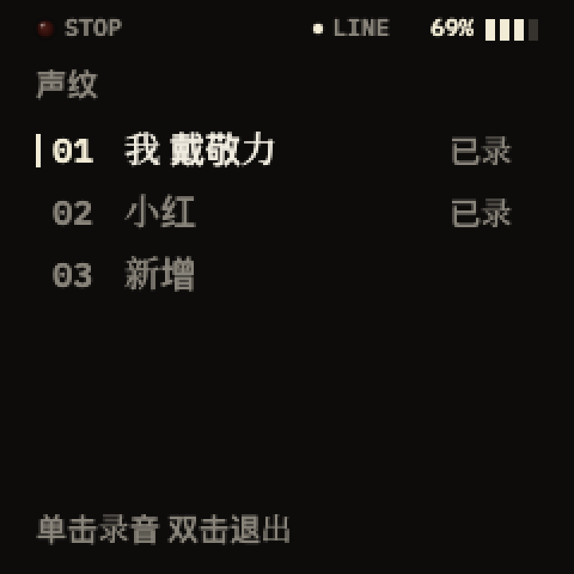 | 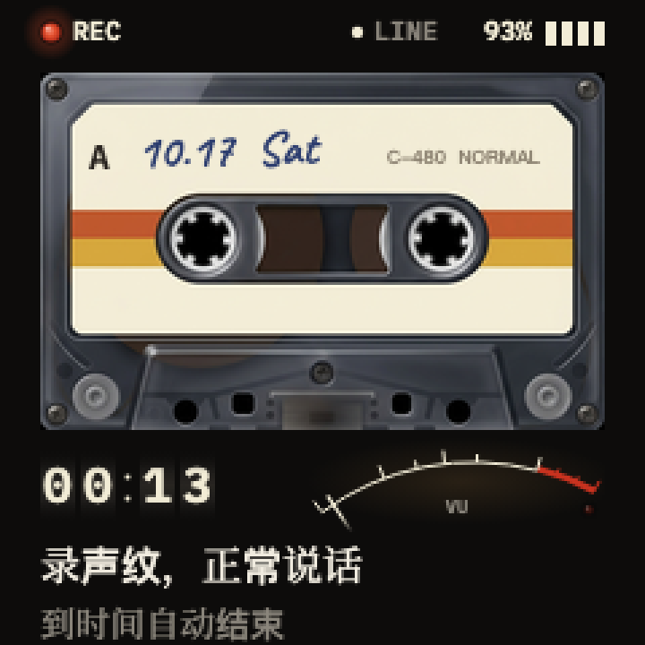 | 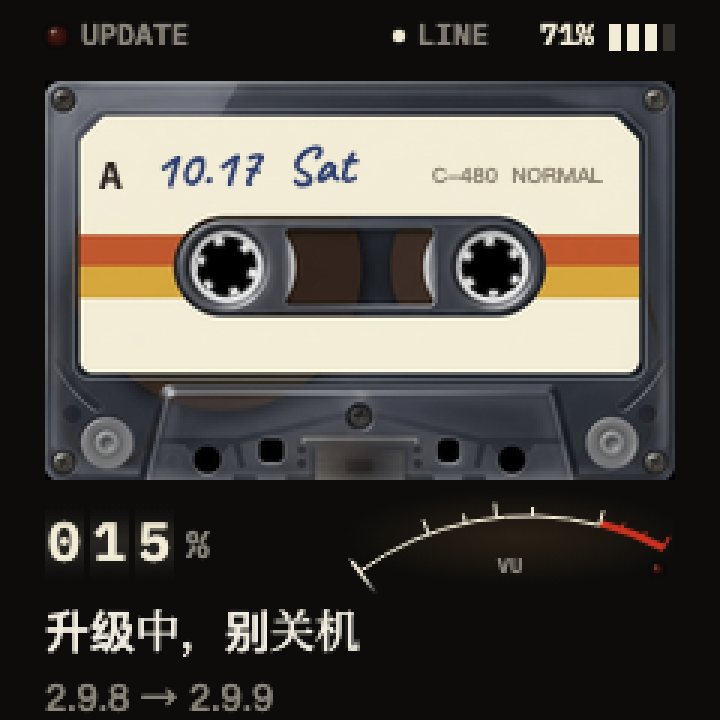 |
| 双击 BOOT。音量键上下选，可以一直新增。录过的右边写「已录」。 | 在名单里单击。倒计时到 0 自己停。记上之后写「录好了」，没听清就写「没听清」。 | 有新版本时自己下载。左下是真进度。下完重启，连不上服务器会退回旧的。 |

| 联网设置 | 电量低 |
| --- | --- |
| 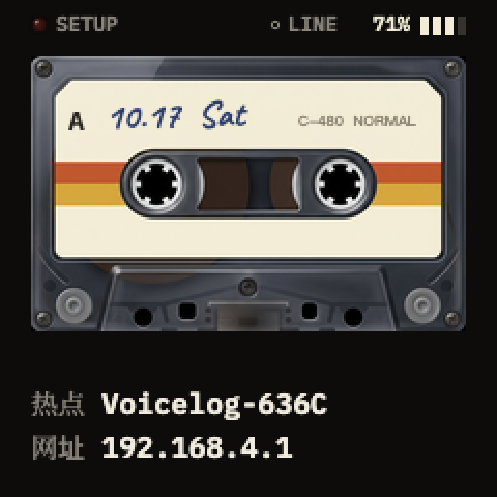 | 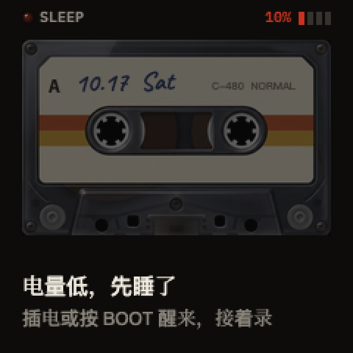 |
| 长按 BOOT。手机连上板子自己的热点，打开上面的网址，把 WiFi 写进去。最多记 10 个。 | 电量到 10% 停录，把攒的传完，然后深睡，不把电放干。插电或按 BOOT 醒来，接着录。 |

动的稿子在 [`design/各状态屏_初稿.html`](design/各状态屏_初稿.html)，用浏览器打开。录音中那一屏单独的定稿是 [`design/录音中一屏_定稿.html`](design/录音中一屏_定稿.html)。磁带、灯、滚轮、VU 的零件在 `design/固件素材/png/`。字和图怎么进固件，写在 [`design/固件素材/README.md`](design/固件素材/README.md)。

## 仓库里有什么

| 目录 | 干什么 |
| --- | --- |
| `server/src/server.mjs` | 入口 |
| `server/src/xiaozhi.mjs` | 板子怎么连上来 |
| `server/src/gate.mjs` `vad.mjs` | 安静的不送去识别 |
| `server/src/asr.mjs` `transcriber.mjs` | 转写 |
| `server/src/speakers.mjs` `printsStore.mjs` | 声纹 |
| `server/src/daylog.mjs` `convs.mjs` | 按天存字，给对话起标题 |
| `firmware/voicelog/voicelog_screen.cc` | 板子上的画面 |

板子代码要放进 [xiaozhi-esp32](https://github.com/78/xiaozhi-esp32) 才能编，板型 `voicelog-zhengchen-1.54`。WiFi 密码和设备令牌不在仓库里。密钥样例是 [`.env.example`](.env.example)。三个声纹模型大约 35MB，放到 `server/models/`：`campplus_zh.onnx`、`segmentation.onnx`、`silero_vad.onnx`。看某一天的账：`node pull.mjs 今天`，第一行会写送去识别几分钟、大约几元。

```bash
cd server
cp ../.env.example .env
npm ci
npm test
npm start
```

转写走阿里百炼，按量算。文字存在腾讯云 COS 的 `voicelog/` 前缀。只有登记过的板子能领到连接地址。
