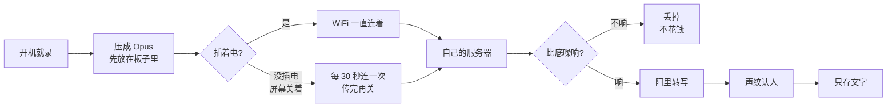
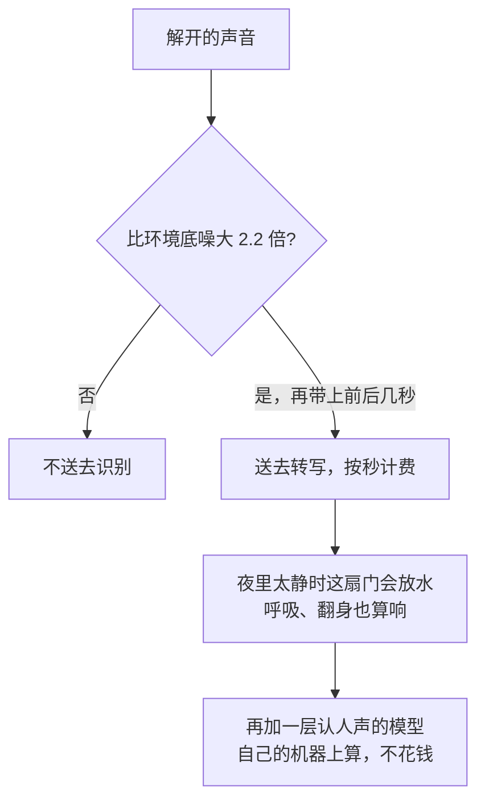

# 随身录音

出门不用记。跟人正常聊，这块小屏一直在听。回来打开今天的文字，每句都有时间，谁说的也能分开。原始声音不留，云上只存字。

它不是手机里的录音 App。开机就录，不用打开，不用盯着屏幕。屏幕做成一台磁带，平时几乎关着，只在给人看的时候打开。

<p align="center">
  
</p>

硬件是买来就焊好的正辰 1.54 寸方屏，ESP32-S3，16MB 闪存，8MB 内存。大约六七十块。三个键：单击 BOOT 开始或停止，双击进声纹名单，长按进联网设置。音量键平时调亮度、开关屏幕；进了声纹页就只用来上下选人。

## 声音怎么变成文字



没插电、屏幕关着时，云上的字最多晚半分钟。这是省电，不是网断了。熄屏满电实测过一次：6 小时 35 分，一秒钟没丢。旁边没有记住的 WiFi，板子里大约留最近 25 分钟，再久丢最早的。没有电话卡，出门靠随身热点。

## 钱花在哪

转写按送出去的秒数算，单价按我们记账时的价目：`paraformer-realtime-v2` 0.00024 元/秒，大约 0.86 元每小时说话。安静的部分不送，就不计费。声纹、认人声、给一句话切开，都在自己的服务器上算，不按分钟收费。一段对话起一次标题，用 `qwen-flash`，可以忽略。



旧门的实测，和新门在本机上的对照：

| 什么情况 | 录了多久 | 送去识别 | 大约花多少 | 结果 |
| --- | --- | --- | --- | --- |
| 夜里睡觉，板子开着 | 3 小时 | 61 分钟 | 0.88 元 | 只认出 9 个「嗯」 |
| 凌晨放在那，没人说话 | 24 分钟 | 20 分钟 | 0.29 元 | 几乎是噪声 |
| 真有人在说话 | 1 小时说话 | 1 小时 | 0.86 元 | 这是正常的账 |
| 电流嗡声 5 秒，换认人声的门 | 5 秒 | 0 秒 | 0 | 本机试的，旧门会整段送出去 |
| 四人对话，换认人声的门 | 521 帧人声 | 519 帧 | 几乎一样 | 漏的是开头 0.1 秒，前后各垫 0.8 秒补上 |

认人声的门线上还在影子对照：字照旧按旧门送，新门只记账，看它会不会把真话漏掉。没漏，再切过去。

## 模型各管一件事

| 干什么 | 用什么 | 在哪算 | 花钱 |
| --- | --- | --- | --- |
| 转写 | paraformer-realtime-v2 | 阿里 | 只算送出去的秒 |
| 有没有人声 | Silero VAD，大约 600KB | 自己的服务器 | 不花 |
| 这句是谁 | CAM++，192 维声纹 | 自己的服务器 | 不花 |
| 一句里有好几个人 | 分段模型，长过 3.5 秒才切 | 自己的服务器 | 不花 |
| 给这段对话起标题 | qwen-flash，凑够 1 分钟或 10 句才请一次 | 阿里 | 可以忽略 |

声纹怎么认：

| 谁 | 怎么处理 |
| --- | --- |
| 登记过的人 | 像到 0.55 以上就认他。15 秒登记对上后来的话，大约 0.58 到 0.66。声纹先存，名字听出来再补。空表不能把已有的人盖掉。 |
| 没登记的人 | 只在这一场里编号。像到 0.60 以上才并进已有的号，免得一句不像就新开一个。隔 5 分钟没说话，这一场的编号丢掉，不写库。 |
| 不到 1 秒 | 声纹不准，跟前一句算同一个人。 |
| 1 到 2 秒 | 只往已有的人上靠，靠不上就写「其他人」，不开新号。 |
| 一句里来回说 | 先切开再认。同一个人被误切成两半，会并回一行。 |

## 和钉钉那张卡

| | 钉钉 A1 Pro | 这块 |
| --- | --- | --- |
| 价钱 | 1299 | 现成焊好的大约 60 到 70 |
| 核心 | 随身听着，回来是文字 | 一样 |
| 续航 | 官方写 180 小时 | 熄屏实测 6 小时 35 分 |
| 没网 | 声音存在卡里 | 大约 25 分钟，满了丢最早的 |
| 联网 | 跟手机、钉钉走 | 只有 WiFi |
| 留下什么 | 录音进钉钉听记 | 只留文字 |
| 转写 | 买卡送几个月，之后是会员 | 自己的服务器，按送出去的秒数算 |
| 另外有的 | 电话录音、翻译、待办、给手机充电 | 没有 |

更早的 A1 青春版 499、旗舰版 799，是另一张卡，官方写 45 小时。1299 指的是 2026 年 4 月那张 Pro。

## 每一屏

屏是 240×240，黑底。中文用宋体，英文和数字用等宽字。顶上那排只有 REC、STOP 这种拉丁词，因为那套字只有英文。底下两行是状态。声纹页把磁带拿开，中间是名单。

| 开机 | 连接中 | 录音中 |
| --- | --- | --- |
|  |  |  |
| 通电后先亮这一屏，版本号是板子上真装的那个。取代小智原来的白屏。 | 正在连 WiFi 和服务器。这时候已经在录，先存在机器里，时间是真的在涨。 | 平时就是这一屏。左下是今天录了多久，右下是麦克风音量，底下是刚说的那句。 |

| 没网 | 补传 | 已停止 |
| --- | --- | --- |
|  |  |  |
| 路上没信号。照样在录，存在机器里，有网了自己补传。 | 刚连上，把存着的那段发出去。传完，字幕就接着出来。 | 单击 BOOT 停下。磁带不转。插着电的时候，电量格子一格格往上走。 |

| 声纹名单 | 录声纹 | 升级中 |
| --- | --- | --- |
|  |  |  |
| 双击 BOOT。音量键上下选，可以一直新增。录过的右边写「已录」。 | 在名单里单击。倒计时到 0 自己停。记上之后写「录好了」，没听清就写「没听清」。 | 有新版本时自己下载。左下是真进度。下完重启，连不上服务器会退回旧的。 |

| 联网设置 | 电量低 |
| --- | --- |
|  |  |
| 长按 BOOT。手机连上板子自己的热点，打开上面的网址，把 WiFi 写进去。最多记 10 个。 | 电量到 10% 停录，把攒的传完，然后深睡，不把电放干。插电或按 BOOT 醒来，接着录。 |

动的稿子在 [`design/各状态屏_初稿.html`](design/各状态屏_初稿.html)，用浏览器打开。录音中那一屏单独的定稿是 [`design/录音中一屏_定稿.html`](design/录音中一屏_定稿.html)。磁带、灯、滚轮、VU 的零件在 `design/固件素材/png/`。字和图怎么进固件，写在 [`design/固件素材/README.md`](design/固件素材/README.md)。

## 仓库里有什么

| 目录 | 干什么 |
| --- | --- |
| `server/src/server.mjs` | 入口 |
| `server/src/xiaozhi.mjs` | 板子怎么连上来 |
| `server/src/gate.mjs` `vad.mjs` | 安静的不送去识别 |
| `server/src/asr.mjs` `transcriber.mjs` | 转写 |
| `server/src/speakers.mjs` `printsStore.mjs` | 声纹 |
| `server/src/daylog.mjs` `convs.mjs` | 按天存字，给对话起标题 |
| `firmware/voicelog/voicelog_screen.cc` | 板子上的画面 |

板子代码要放进 [xiaozhi-esp32](https://github.com/78/xiaozhi-esp32) 才能编，板型 `voicelog-zhengchen-1.54`。WiFi 密码和设备令牌不在仓库里。密钥样例是 [`.env.example`](.env.example)。三个声纹模型大约 35MB，放到 `server/models/`：`campplus_zh.onnx`、`segmentation.onnx`、`silero_vad.onnx`。看某一天的账：`node pull.mjs 今天`，第一行会写送去识别几分钟、大约几元。

```bash
cd server
cp ../.env.example .env
npm ci
npm test
npm start
```

转写走阿里百炼，按量算。文字存在腾讯云 COS 的 `voicelog/` 前缀。只有登记过的板子能领到连接地址。
